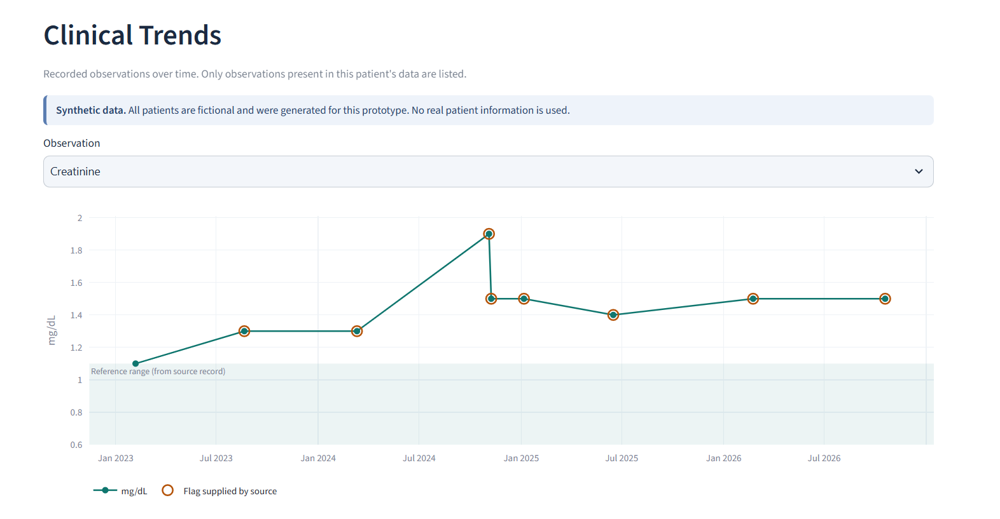
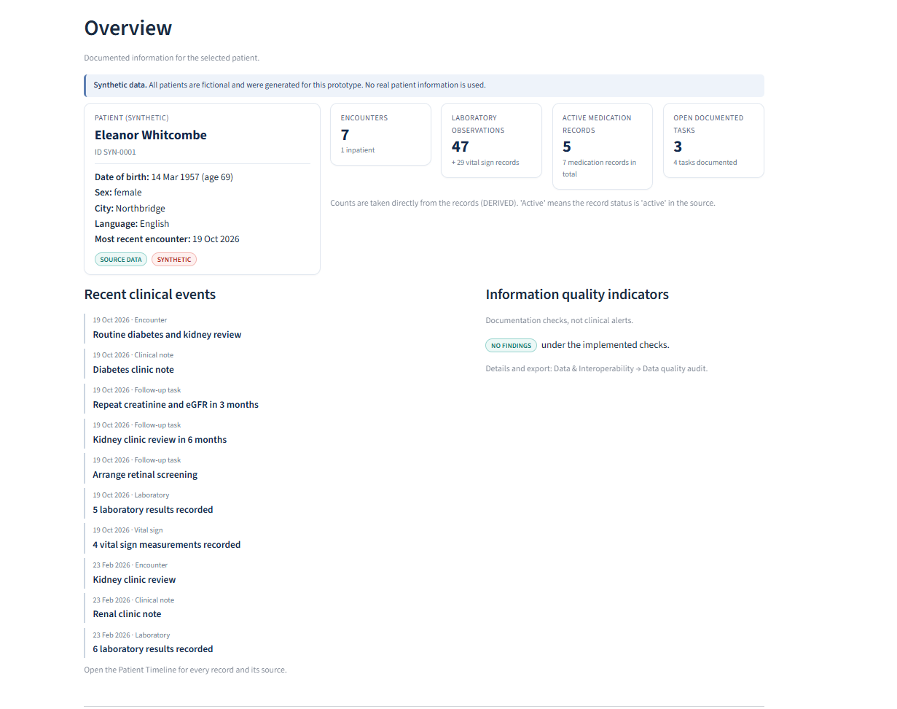
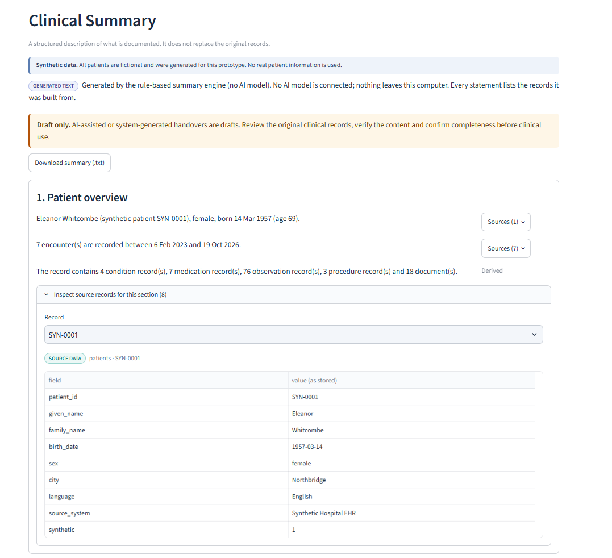
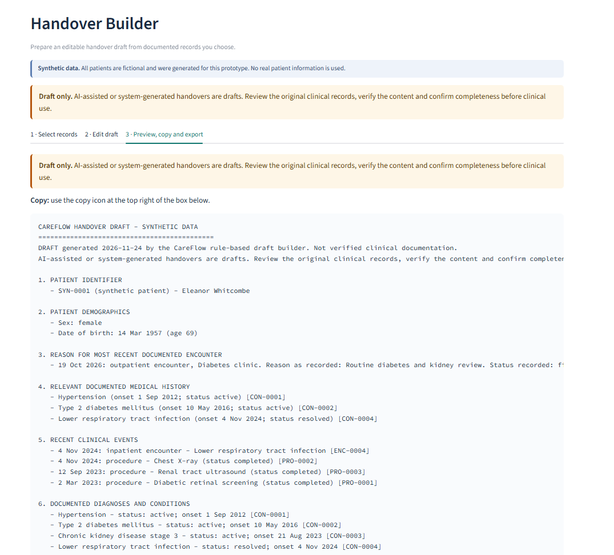

# CareFlow — Clinical Timeline & Handover Intelligence



## Screenshots

**Overview**



**Clinical Summary with source traceability**



**Handover Builder (editable draft)**



An **educational and research prototype** that shows how a clinician could navigate a patient's longitudinal records,
review trends, prepare an editable handover draft and trace every generated statement back to its source record.

> CareFlow is an educational and research prototype using synthetic data. It is not a medical device, electronic health record
> replacement or clinical decision-making tool. Information displayed is not intended to diagnose, treat or manage medical
> conditions. Generated summaries and handovers require human review and verification. The application has not been clinically validated.

* All 6 patients are **fictional**. No real data, no external services, no API keys, nothing leaves your computer.
* There is **no AI model** in this prototype. Summaries and handovers come from a rule-based Python engine.
* The FHIR mapping is **FHIR-inspired (R4)**, not validated or certified as conformant.

## 1. Quick start (beginner friendly)

You need Python 3.10 or newer (https://www.python.org/downloads/). Open a terminal (Windows: "Command Prompt" or "PowerShell"; Mac: "Terminal") and go into the `CareFlow` folder.

```bash
# 1. Create an isolated environment (recommended)
python -m venv .venv

# 2. Activate it
#    Windows:   .venv\Scripts\activate
#    Mac/Linux: source .venv/bin/activate

# 3. Install the packages
pip install -r requirements.txt

# 4. Start the app (a browser tab opens at http://localhost:8501)
streamlit run app.py
```

On first start the app creates `data/careflow.db` (SQLite) from the synthetic generator. Stop the app with `Ctrl+C`.

Run the automated tests (optional): `pytest`

## 2. Using the app

Pick a **synthetic patient** in the sidebar, then use the navigation:

| Page | What it does |
|---|---|
| Overview | Identity panel, counts taken from the records, recent events, information-quality indicators |
| Patient Timeline | Search, category / date / encounter / observation filters, sort, expandable records with source document text |
| Clinical Trends | Interactive chart per observation, source reference range and flags (only if present in the data), underlying table, source inspection |
| Clinical Summary | 10-section rule-based summary; every sentence has a **Sources** popover; each section has a source inspector |
| Handover Builder | Choose records → generate draft → edit → preview, copy, download (.txt / .md) |
| Data & Interoperability | FHIR-style JSON explorer, mapping table, simplified structural check, bundle export, **data quality audit** (report + CSV export), raw tables |
| About CareFlow | Problem statement, research question, evaluation framework, ethics requirements, safety statements |

**Reset demonstration dataset** (sidebar) deletes and regenerates the database and clears your handover edits.

Suggested demo patients: `SYN-0001` rich longitudinal history and trends · `SYN-0003` incomplete record · `SYN-0006` missing sources, conflicts, mixed units · `SYN-0002` outstanding follow-up imaging · `SYN-0004` conflicting medication doses · `SYN-0005` short two-trend history.

## 3. Project structure

```
CareFlow/
├── app.py                    # Streamlit entry point: sidebar, patient selection, page routing
├── requirements.txt
├── .streamlit/config.toml    # light clinical theme, usage statistics disabled
├── data/
│   ├── synthetic_patients.json   # the full synthetic dataset (regenerated on reset)
│   └── sample_fhir.json          # example FHIR-style bundle for SYN-0001
├── database/
│   ├── schema.sql            # SQLite tables (NULL = "not recorded")
│   └── database.py           # create / seed / reset / read functions
├── modules/                  # one file per feature
│   ├── dashboard.py  timeline.py  analytics.py  summarisation.py
│   ├── handover.py   interoperability.py  data_quality.py  search.py  about.py
├── utils/
│   ├── synthetic_data.py     # hand-authored fictional patients
│   ├── data_processing.py    # formatting, unified record view, normalisation rules
│   ├── fhir_mapping.py       # record → FHIR R4-style resources + simplified validator
│   └── ui.py                 # CSS, badges, banners
└── tests/test_careflow.py    # 59 automated checks
```

**Architecture in one paragraph.** `synthetic_data.py` builds the records → `database.py` stores them in SQLite → `app.py` loads one patient's tables into pandas DataFrames (a "bundle") → each module receives `(patient, bundle)` and renders one page. Logic (filters, summary engine, handover builder, audit, FHIR mapping) lives in pure functions that are unit-tested; Streamlit code is limited to `render()` functions.

## 4. Functional vs simulated

| Genuinely functional | Simulated / illustrative |
|---|---|
| SQLite storage, reset, search and filters, charts, source inspection, rule-based summary with per-statement sources, handover builder with editing/export, FHIR-style JSON export, simplified structural validation, data quality audit and report export | All patient data; LOINC/SNOMED codes (not checked against a terminology server); FHIR mapping (no official validator); the `ExternalModelEngine` class is only a documented placeholder and is **not** selectable or connected |

Not implemented: AI summarisation, PDF export, authentication, real EHR integration, FHIR Task/ServiceRequest mapping for follow-up tasks.

## 5. How the synthetic data works

`utils/synthetic_data.py` contains hand-written patient stories (not random numbers) so each record relates sensibly to the others. Laboratory reports are generated *from* the observation rows, so a report and its results always agree. Flags and reference ranges are stored as if supplied by the source lab; **CareFlow never computes normal/abnormal itself**. Missing values are stored as `NULL` and shown as "not recorded".

## 6. How summaries, handovers and the audit are generated

* **Summary** (`summarisation.py`): templates turn stored fields into sentences (dates and units preserved). Each `Statement` carries the ids of the records it used; the UI shows them. It describes first/latest/highest/lowest values and says "insufficient data" for fewer than 3 measurements. It never interprets, diagnoses or labels.
* **Handover** (`handover.py`): 12 fixed sections built only from the records you tick. It adds a verification warning, a list of missing/conflicting items for the selected records, a sources list and a human sign-off block. It never recommends treatment or assigns stability/urgency (checked by tests).
* **Audit** (`data_quality.py`): rule-based checks for missing dates/values/units/sources, duplicates, conflicting entries, inconsistent terms or units, incomplete or possibly outdated medication records, and mapping limitations. Findings describe documentation, not clinical risk. Normalisation (e.g. "HTN" → "Hypertension") is logged next to the original text; source rows are never changed.

## 7. Technical limitations

* Free-text plans inside notes are **not** extracted; only structured tasks are used (the app says so).
* The synonym list for normalisation is tiny and illustrative.
* "Potentially outdated" uses simple rules (end date passed, or no review for 12+ months relative to today's date).
* Values in different units are shown separately and are not converted.
* Copy uses the copy icon on the preview box (Streamlit code blocks); a one-click clipboard button is not available without custom JavaScript.
* Not clinically validated; no usability study has been performed.

## 8. Technical skills demonstrated

Python packaging and modular design · SQLite schema design and SQL · pandas data wrangling · Plotly interactive charts · Streamlit app development and state handling · health-data modelling (encounters, conditions, observations, medications) · HL7 FHIR R4 resource mapping and basic validation · data provenance and data quality auditing · rule-based natural-language generation · responsible-AI design (transparency, human oversight, no clinical inference) · automated testing (pytest, Streamlit AppTest) · research design framing.

## 9. Suggested next steps

1. Run the official HL7 FHIR validator on the exported bundle and fix findings; add Task/ServiceRequest mapping.
2. Import Synthea output (FHIR JSON) as an additional data source.
3. Add proper terminology handling (LOINC, SNOMED CT, RxNorm/dm+d) via a local terminology file.
4. Prototype an AI summariser behind the `SummaryEngine` interface with a strict citation contract and compare it against the rule-based output.
5. Add PDF export, audit logging and user roles.
6. Plan a small formative usability study with clinicians (ethics approval first).

## 10. What to learn next

Python basics (functions, dicts, lists) → pandas (`DataFrame`, filtering, `groupby`) → SQL (`SELECT`, `JOIN`) → Streamlit (widgets, `session_state`) → Plotly → HL7 FHIR basics (Patient, Encounter, Observation) and LOINC/SNOMED → pytest → clinical informatics literature on handover and usability evaluation (SUS, NASA-TLX).
## What I learned

- **Systems and scale:** A well-structured system can reduce problems with patient information. But building one system for a single hospital is very different from connecting a whole country's healthcare. Different organisations record the same information in different ways, which is why shared standards such as FHIR matter.
- **Technical:** I learned how to set up a Python virtual environment, which keeps a project's packages separate from the rest of the computer so the app runs the same way each time.

## What I want to do next

- Check the FHIR export with the official HL7 FHIR validator.
- With ethical approval and data-protection safeguards in place, ask clinicians to test CareFlow and give feedback on how it would work in real hospital settings. This prototype has only used synthetic data and has not been clinically validated.